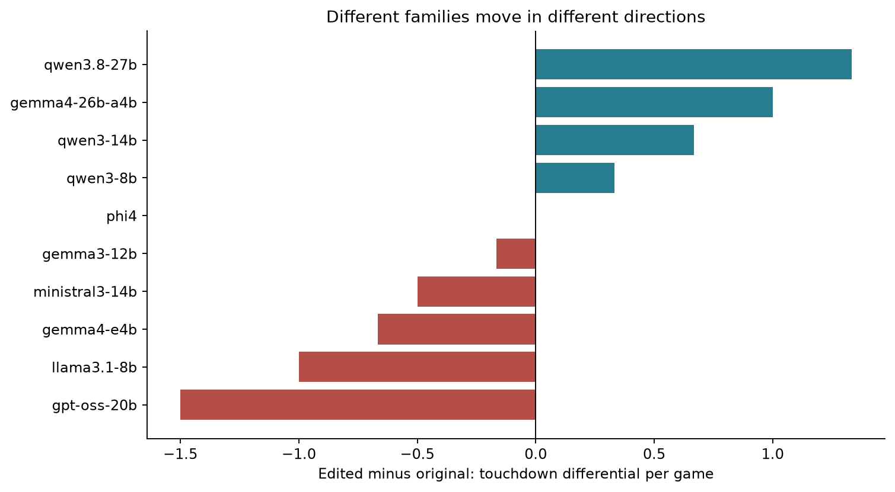
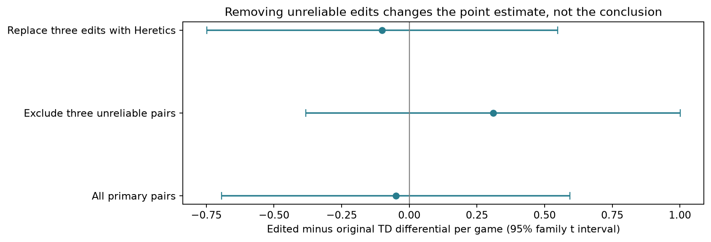
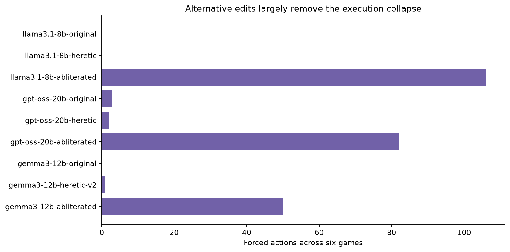
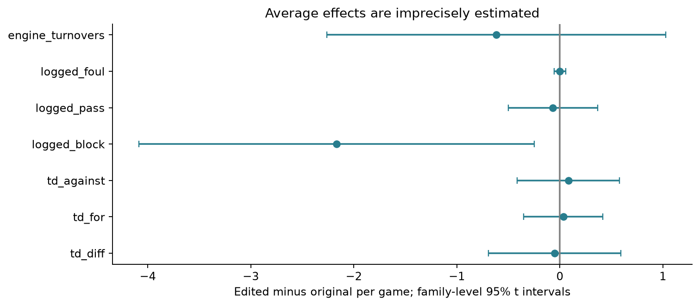
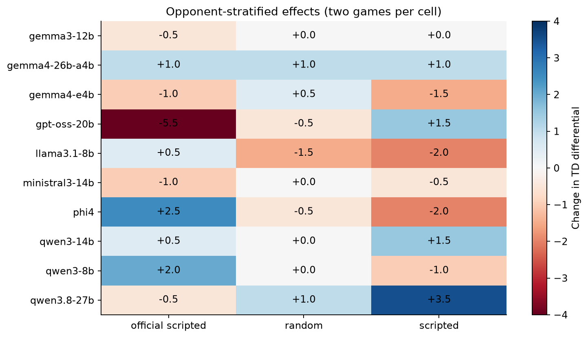

::: {.callout-note}
## Working draft, not a causal verdict
This is an exploratory skeleton based on a completed local tournament. Analyses were specified after interim results had been inspected. The estimates compare particular released artifacts, not a randomly assigned intervention. Tables and figures are computed from the completed data; the interpretation remains provisional.
:::

## The question

Removing refusal-related directions from a language model's weights is often discussed as if it changes one behaviour and leaves everything else intact. Here the question is narrower and measurable: **does an edited version play differently from its original in a tactical game?** And if it struggles, is that weak tactical play or an inability to execute decisions?

The setting is Bot Bowl, a stochastic fantasy-football simulator. This experiment uses the existing BotBowl Bench harness, not a new game implementation. A model chooses actions against fixed control policies. Success requires moving the ball, managing risk and completing actions, rather than merely producing plausible commentary. Fouling is an in-game tactical action, not a measure of real-world harmfulness.

## What we ran

The final dataset contains **144 completed games**: 138 local-model games and six control-control games. There are **23 local artifacts**: ten original/primary-edit pairs, plus independent Heretic alternatives for Gemma3, GPT-OSS and Llama. Each artifact played the same three distinct controls, once home and once away. The controls are Scripted baseline, Random baseline and the official Bot Bowl scripted bot.

All final-run local contestants used constrained JSON and the same phase-aware action-assistance interface. Assistance constrains available actions; it does not supply strategy or prevent legal but unproductive repetition. Granite was excluded as an entire pair following compatibility failures. Earlier native/mixed-interface experiments and superseded GPT reasoning conditions are not pooled here.

**All 144 games have different seeds.** Pairing means the same family, opponent and side, not a replay of identical dice. Each artifact has only six games. These are within-family fixture comparisons, not common-random-number trials.

### Comparison and provenance audit

| Family | Primary edit lineage | Additional comparator / material caveat |
|---|---|---|
| Qwen3-8B | Mlabonne | Q4_K_M label does not guarantee identical conversion |
| Llama3.1-8B | Mlabonne | p-e-w Heretic added independently |
| Ministral3-14B | jenerallee78 | Documented norm-preserving biprojected edit |
| Gemma3-12B | Mlabonne v2 | DreamFast Heretic v2; embedded top_k 64 versus 40 |
| Phi-4 | Orion-zhen | Community artifact comparison |
| Qwen3-14B | Mlabonne | Community artifact comparison |
| GPT-OSS20B | Huihui BF16-derived edit | p-e-w Heretic; reconstruction/quant lineage confound; explicit low reasoning |
| Gemma4-E4B | Madras1 | Architecture-specific conversion caveats |
| Gemma4-26B-A4B | WWTCyberLab | Intervention includes embedding suppression |
| Qwen3.8-27B | JonathanColetti | Materially different GGUF layout/size despite quant label |

The alternatives were selected to test whether severe failures were peculiar to an edit, not to replace losses retrospectively. Exact revisions and hashes are retained in the private research manifest. No raw private transcripts are published here.

## Estimating the within-family difference

The primary regression is:

$$Y_{f,o,s,e} = \alpha_{f,o,s} + \beta\,\mathrm{Edited}_e + \varepsilon_{f,o,s,e}.$$

The fixed effects identify family-by-opponent-by-side fixture strata. The primary outcome is touchdown differential per game; secondary outcomes cover scoring, winning, execution reliability and observable actions. The original primary edits are the primary analysis. Alternative edits are separate sensitivity analyses.

In this balanced design, the coefficient equals the mean of the ten family-level differences. Family-level Student-t intervals use nine degrees of freedom. These independently reproduce the prior implementation's CR2/Bell-McCaffrey intervals for the overlapping score outcomes. The primary restricted wild-cluster Rademacher bootstrap also fails to reject zero (p=0.906). This is model-based inference under strong small-sample assumptions, not randomization inference. The families are a convenience sample, and related architectures can weaken independence further.

The simpler additive family/opponent/side model gives the same primary point estimate. Tool calls and turns are not treated as independent experimental replicates. We do not control for forced actions in the score regression: execution failure may be part of the pathway from an artifact to performance, so adjusting it away would change the question.

## Main result: no clear average score effect

The primary estimate is **−0.05 touchdowns of differential per game**, with a **95% interval from −0.69 to +0.59**. This is inconclusive, not evidence of equivalence. The data remain compatible with differences that would matter in a low-scoring game.

| family         |   estimate |
|:---------------|-----------:|
| gemma3-12b     |     -0.167 |
| gemma4-26b-a4b |      1.000 |
| gemma4-e4b     |     -0.667 |
| gpt-oss-20b    |     -1.500 |
| llama3.1-8b    |     -1.000 |
| ministral3-14b |     -0.500 |
| phi4           |      0.000 |
| qwen3-14b      |      0.667 |
| qwen3-8b       |      0.333 |
| qwen3.8-27b    |      1.333 |

Qwen3.8-27B and Gemma4-26B-A4B improved in this sample; GPT-OSS and Llama deteriorated. Averaging hides that heterogeneity. Neither the positive nor negative family result alone establishes a general editing-method effect.

## Does excluding the unreliable edits change the result?

The three flagged primary edits were Gemma3, GPT-OSS and Llama. We report the requested exclusion **symmetrically**, dropping both members of each affected pair. A second sensitivity keeps all ten families but substitutes all three independent Heretics together. We do not choose each family's highest-scoring edit.

| Specification                     |   Families |   Fixture contrasts |   Difference |   95% lower |   95% upper |
|:----------------------------------|-----------:|--------------------:|-------------:|------------:|------------:|
| Primary edits                     |         10 |                  60 |       -0.050 |      -0.693 |       0.593 |
| Exclude unreliable primary pairs  |          7 |                  42 |        0.310 |      -0.382 |       1.001 |
| Replace three edits with Heretics |         10 |                  60 |       -0.100 |      -0.749 |       0.549 |

Removing the three affected pairs changes the estimate from slightly negative to **+0.31**, but the interval still spans zero. Replacing their edits with Heretics gives **−0.10**, also inconclusive. **The tactical conclusion is not rescued by cleaning up the execution failures.** The exclusions are outcome-informed exploratory checks, not a pre-registered clean sample.

The three Heretics alone average −1.06 relative to their originals. Their corresponding primary edits already average −0.89 on these same families. That is not a fair basis for claiming Heretic is generally worse: these were specifically the problematic families, only three were studied, and the matches use different seeds. We do not promote the small-three-family parametric p-value to a general method claim.

## Reliability is a different, stronger descriptive story

| artifact                |   wins |   draws |   losses |   td_for |   td_against |   forced |   invalid |   deadlines |
|:------------------------|-------:|--------:|---------:|---------:|-------------:|---------:|----------:|------------:|
| gemma3-12b-abliterated  |      0 |       2 |        4 |        1 |           20 |       50 |         0 |           0 |
| gemma3-12b-heretic-v2   |      1 |       1 |        4 |        1 |           24 |        1 |         0 |           0 |
| gemma3-12b-original     |      0 |       2 |        4 |        0 |           18 |        0 |         0 |           0 |
| gpt-oss-20b-abliterated |      0 |       4 |        2 |        0 |           15 |       82 |         0 |          75 |
| gpt-oss-20b-heretic     |      0 |       2 |        4 |        1 |           15 |        2 |         0 |           2 |
| gpt-oss-20b-original    |      1 |       1 |        4 |        1 |            7 |        3 |         0 |           3 |
| llama3.1-8b-abliterated |      0 |       1 |        5 |        0 |           14 |      106 |       314 |           0 |
| llama3.1-8b-heretic     |      0 |       2 |        4 |        0 |           14 |        0 |         0 |           0 |
| llama3.1-8b-original    |      2 |       1 |        3 |        3 |           11 |        0 |         0 |           0 |

The primary edits produced large, concentrated execution failures. Alternative Llama ran without invalid calls or forced actions. GPT Heretic needed two forced actions versus Huihui's 82. Gemma Heretic needed one versus Mlabonne's 50. These alternatives did **not** uniformly improve scores.

Across all ten pairs, the primary edits average +3.92 forced actions per game. With the three alternatives substituted, the mean difference is zero in this sample. That does not imply every artifact has identical reliability: GPT Heretic has one fewer forced action than its original across six games, while Gemma Heretic has one more. Reliability improved sharply for these specific alternative artifacts; method-wide causality remains unidentified.

### Regression summary

| Outcome            |   Difference |   95% lower |   95% upper |     p |    BH q |
|:-------------------|-------------:|------------:|------------:|------:|--------:|
| td_diff            |       -0.050 |      -0.693 |       0.593 | 0.864 | nan     |
| td_for             |        0.033 |      -0.351 |       0.418 | 0.849 |   0.894 |
| td_against         |        0.083 |      -0.414 |       0.581 | 0.713 |   0.865 |
| win                |       -0.017 |      -0.148 |       0.115 | 0.780 |   0.867 |
| forced_actions     |        3.917 |      -0.861 |       8.695 | 0.097 |   0.434 |
| invalid_tool_calls |        5.283 |      -6.543 |      17.110 | 0.339 |   0.538 |
| deadline_cutoffs   |        1.200 |      -1.515 |       3.915 | 0.343 |   0.538 |
| logged_block       |       -2.167 |      -4.086 |      -0.247 | 0.031 |   0.418 |
| logged_foul        |        0.000 |      -0.056 |       0.056 | 1.000 |   1.000 |
| logged_start_blitz |       -1.200 |      -2.345 |      -0.055 | 0.042 |   0.418 |

Counts are per game; `win` is a probability difference. `logged_*` denotes tool-layer primitive/activation records, not successful outcomes. The BH adjustment covers the complete primary secondary-outcome set in the downloadable table, including the exploratory behavioural checks. The primary score outcome is not included in that adjustment. Intervals for sparse/skewed counts are descriptive approximations; ordinary linear intervals can cross zero for nonnegative outcomes because they describe a difference.

## What changes in play?

There is an unadjusted decrease in logged BLOCK primitives (−2.17 per game, p=0.031) and START_BLITZ activations (−1.20, p=0.042). Neither survives the secondary-outcome multiple-testing adjustment. With unreliable pairs excluded or Heretics substituted, the BLOCK difference's interval also spans zero. It would be premature to call this reduced aggression.

**An important measurement trap:** the harness's `blocks`, `passes`, `handoffs` and `fouls` summary counters count action *starts*. They do not count completed attacks, successful passes or actual foul primitives. Across the local games, the transcript contains 2 FOUL primitive records, while the summary reports 15 foul activations. Those quantities answer different questions. Similarly, a blitz can contain a BLOCK primitive without being a BLOCK_ACTION_STARTED event.

We therefore analyse tool-layer action records separately from engine activation counters. A recorded primitive means it reached the action-submission path, not that a roll succeeded. Exact attribution of forced actions is unavailable. Missing primitive observations or zero event totals must not be read as a precise estimate of unwillingness.

Foul opportunities were not logged as a complete, unique state-level exposure. The interface's offered-tool lists can identify some opportunities, but repeated replies and legal alternatives make them an unsuitable denominator for a clean foul-choice rate. **We cannot estimate willingness to foul convincingly from this run.** It needs state-level opportunity instrumentation or matched-state probes.

The supplemental extraction also measures consecutive identical tool calls and notebook-update calls. Repetition is observable but is not automatically a legal no-op: game state can change between apparently identical actions. These exploratory differences are imprecise and do not survive multiplicity adjustment. The data do not justify claims about personality or real-world dangerousness.

## Opponents and sensitivity

Leaving one family out moves the primary estimate between **-0.20 and +0.11**. Removing one opponent moves it between −0.10 and +0.03. There is no stable directional average effect in these checks. The full robustness table also includes the whole-pair exclusions and Heretic-replacement specifications.

A clean-execution subset is supplied only as a diagnostic in the research analysis: selecting on successful execution is selecting on something the edit itself may affect. It cannot identify an unaffected tactical effect. Equally, rate denominators such as turns or actions can change because of the edit; rate estimates describe conditional behaviour, not total effects.

## Limitations and the next experiment

- Only six games per artifact, different seeds and a selected set of families. Narrow-looking intervals from three alternatives are particularly fragile.
- These are released-artifact contrasts. Family fixed effects cannot remove within-family quantization, conversion, sampling, calibration or editing-method differences.
- Constrained JSON plus phase-aware assistance defines the tested system. Native tool failures from earlier runs are a separate condition.
- The logged Git commit does not fully identify the executed harness: action-assist changes were uncommitted and were not fingerprinted. The exact historical code cannot now be certified.
- Seven tool-call count discrepancies appear across four resumed games (three local seats and four control seats). Current code provides a restart-accounting explanation, but it has not been verified by replay. We retain source-specific counts and do not use these disputed tool-call denominators to estimate causal behaviour rates.
- All transcript files were present; integrity checks and analysis tests passed. Integrity is not a guarantee that every construct is measured correctly.
- Analysis choices followed interim inspection. Secondary analyses and exclusions are exploratory, with null results retained.

The follow-up should use multiple independent edits per family, matched conversion and explicit sampling defaults, common seed schedules with repeated games, and saved-state decision probes. Fouling should be measured as a choice conditional on a genuine legal opportunity. Refusal removal itself should also be measured if the aim is to relate intervention strength to gameplay: the label 'abliterated' is not an intervention-dose measurement.

## Bottom line

**No clearly measurable average score effect emerges from this small tournament.** Excluding unreliable pairs changes the point estimate, but not that conclusion. Independent alternatives show that the spectacular execution failures are not inevitable properties of all edited versions of these families. Clean execution, however, is not the same as competent football.

## Tables and reproducibility

- [All regression and sensitivity outcomes](paired_metric_regressions.csv)
- [Family-level differences](family_metric_differences.csv)
- [All artifact results](artifact_summary.csv)
- [Leave-one-family and opponent checks](robustness.csv)

Analysis uses a frozen SQLite snapshot, with SHA-256 `65057c8ca0176f20cb9e211d95a2debcd9eff7dcc9245a685237a5d2626298c0`. The extraction and regression tests passed locally; an independent recomputation verified the balanced fixed-effect estimates and score intervals. Bulk data, exact artifact manifests and raw transcripts remain in the private research workspace. This draft does not claim to be the first study of edited models in games.
